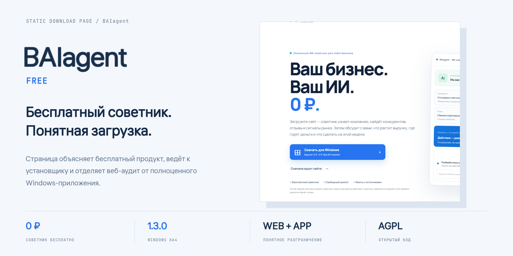
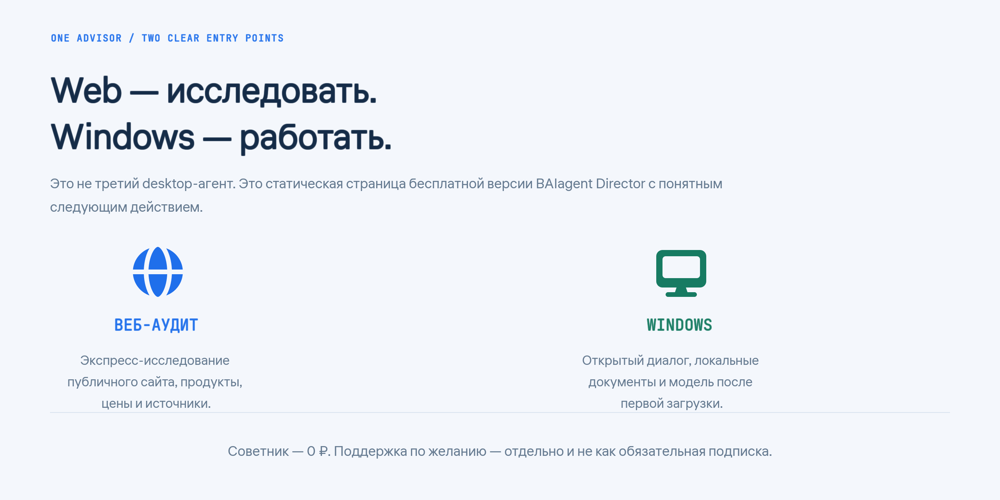

<div align="center">
  
  <p><strong>Бесплатный советник. Понятная загрузка.</strong></p>
  <p>Отдельный статический сайт бесплатной Windows-версии BAIagent — не третий desktop-агент.</p>
  <p><a href="#что-на-странице">Что на странице</a> · <a href="#разработка">Разработка</a> · <a href="https://baiagent.ru/free/">Открыть страницу</a> · <a href="https://github.com/Balanov/baiagent-director">Основной продукт</a></p>
</div>

Отдельный статический сайт бесплатной Windows-версии [BAIagent — ИИ-советник](https://baiagent.ru/free/). Это не третий desktop-агент: сайт объясняет бесплатный продукт, ведёт к установщику и позволяет запросить необязательную поддержку.

[Исходный код этой страницы](https://github.com/Balanov/baiagent-free) · [Репозиторий ИИ-советника](https://github.com/Balanov/baiagent-director) · [Релиз ИИ-советника 1.3.0](https://github.com/Balanov/baiagent-director/releases/tag/v1.3.0)

## Что на странице

- Скачивание ИИ-советника 1.3.0 для Windows за 0 ₽.
- Переход к веб-аудиту компании.
- Честное разграничение веб-версии и локального приложения.
- Описание локальных документов, диалога и необходимости интернета для свежих исследований.
- Отдельная платная поддержка по желанию — без превращения её в обязательную подписку.
- Форма заявки на поддержку на существующий серверный обработчик BAIagent.

Исходники самого приложения, desktop-контур и enterprise-режим находятся в репозитории `baiagent-director`.

<div align="center">
  
  <p><sub>Web — экспресс-исследование. Windows — диалог, документы и локальная модель. Поддержка по желанию, не обязательная подписка.</sub></p>
</div>

## Разработка

Требуется Node.js 22.12+ и npm.

```bash
npm ci
npm run dev
```

Сборка:

```bash
npm run build
```

Результат появляется в `dist/`. Публикация рассчитана на каталог `/free/` сайта `baiagent.ru`; ссылки на установщик ведут в `/xray/downloads/`.

## Проверка

```bash
node validate-preview.mjs
```

Перед публикацией проверены `npm ci` и production-сборка Vite.

## Лицензия

[AGPL-3.0-or-later](LICENSE).
